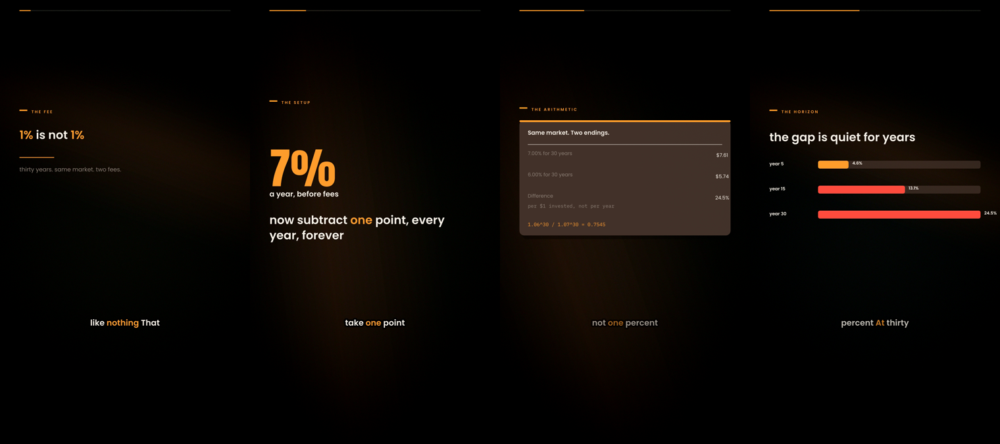

# LEAP

**A vertical video engine you own.** One command turns a topic into a finished,
captioned, broadcast-loudness 9:16 video — then uploads it.

```bash
leap make "why a 1% fee costs 24% of your retirement" --niche business
```

```bash
leap make "…"   #  write → lint → narrate → design → render
                   ~2 s     0 s     ~20 s     ~3 s     ~90 s (CPU only)
```

No web app. No subscription. No stock footage. No template library you can't
edit. Python standard library plus ffmpeg, and every pixel is generated from
your own palette, your own type, your own words.



▶ **[Watch the finished file: `test/TEST.mp4`](test/TEST.mp4)** — 34 s, 1080×1920, 3.9 MB,
committed to this repo, rendered by this code. Silent by design (`--tts none`);
see [test/README.md](test/README.md) for what that mode does and how to voice it.

---

## What actually breaks faceless channels in 2026

Not AI. **Sameness.**

YouTube renamed its "repetitious content" policy to **inauthentic content** in
July 2025 and clarified it on **16 July 2026**: three buckets can't monetise —
(1) generic, repetitive or template-based content, (2) off-putting/distressing
content, (3) synthetic personas presenting as experts on health, legal or
financial topics. In January 2026 it removed 16 large AI-heavy channels with
~4.7bn lifetime views. Concurrently, from **1 February 2027**, YPP entry doubles
to **8,000 watch hours / 20 million Shorts views**.

Every open-source "faceless video" repo in the wild optimises for the one thing
now penalised: volume of interchangeable output. LEAP optimises for the thing
still allowed:

> **Format may repeat. Substance cannot.**

So LEAP ships a *writer* that refuses to invent numbers, a *design system* that
makes each episode look like an issue rather than a slide, and a *lint pass*
that fails the build on engagement bait before you spend a cent on narration.

Read the full reasoning, with sources: **[docs/monetization.md](docs/monetization.md)**.

---

## Why this instead of the existing repos

| | Stars | What it is | The gap LEAP closes |
|---|---|---|---|
| **harry0703/MoneyPrinterTurbo** | ~135k | Keyword → stock-footage montage | Pexels clips + one stock voice = textbook "template-based"; nothing to say |
| **RayVentura/ShortGPT** | ~8k | Framework, abandoned Feb 2025 | Unmaintained; no captions/timing polish |
| **FujiwaraChoki/MoneyPrinter** | ~14k | MoviePy shorts | Same stock-footage shape; MoviePy is slow and pixel-fragile |
| **rushindrasinha/youtube-shorts-pipeline** | ~2.3k | Topic → B-roll → upload, ~$0.11 | Strong pipeline, but renders *images* over an AI voice; the look is generic |
| **hassancs91/claude-faceless-shorts-creator** | ~280 | Claude Code + Remotion TSX shorts | Genuinely excellent craft, but it is a *skill you drive*: you sit in the loop for every video, and Remotion + Chromium is a heavy dependency |
| **darkzOGx/youtube-automation-agent** | ~4.5k | Node agent that runs a channel | Approval-workflow heavy, provider sprawl, and no design language of its own |
| **LEAP** | — | **A design engine with a writer attached** | See below |

LEAP's four actual differentiators:

1. **Pixels are code, not assets.** Backgrounds are animated multi-stop gradient
   fields, grain and vignette built in ffmpeg; typography is libass with bundled
   SIL-OFL fonts. Deterministic, licence-free, reproducible, 34-second 1080×1920
   render in ~90 s on a laptop CPU. Nothing to license, nothing to leak.
2. **Word-exact karaoke captions.** ElevenLabs character alignment when
   available; otherwise a syllable-weight model snapped onto real silences
   detected by `silencedetect`. Captions sit *on* the speech, not near it.
3. **The shot is the unit of content, not the template.** Eleven semantic shot
   kinds (`stat`, `receipt`, `compare`, `chart`, `timeline`, `terminal`,
   `quote`, `flash`, `list`, `statement`, `endcard`). A writer composes them; a
   designer lays them out; pacing takes `max(narration, reading time)` so text is
   never cut mid-animation.
4. **It is a CLI you can pipe.** `script.json` is a documented contract, so any
   model — Claude, GPT, Gemini, a local Llama — can write for it, and you can
   hand-edit one shot without touching the renderer.

---

## Quick start

```bash
git clone <this repo> leap && cd leap
python3 -m pip install -r requirements.txt      # optional extras only
export ANTHROPIC_API_KEY=…                      # or OPENAI_API_KEY / GEMINI_API_KEY
export ELEVENLABS_API_KEY=…                     # or OPENAI_API_KEY, or edge-tts (free)

leap doctor                                     # toolchain check
leap demo --tts none                            # 34 s silent demo, no keys needed
leap make "why a 1% fee costs 24% of your retirement" --niche business
```

Requires **Python 3.11+** and **ffmpeg** on `PATH` (or `pip install imageio-ffmpeg`).
With `--tts none` it renders motion + captions with no API keys at all, which is
the fastest way to see whether the design is for you.

Output lands in `out/<slug>/`: `video.mp4`, `overlay.ass`, `captions.srt`,
`script.json`, `description.txt`, `manifest.json`, and QA frames if you asked.

---

## The commands

| Command | What it does |
|---|---|
| `leap make "topic"` | write → lint → voice → render, all of it |
| `leap write "topic" --niche space --brief research.md` | topic → `script.json` (facts allowed only from the brief) |
| `leap lint script.json` | 20 checks: hook, word budget, bait, banned phrases, numeric claims without sources |
| `leap revise script.json "make shot 3 a receipt"` | surgical edit, schema preserved |
| `leap frames script.json` | layout stills only — iterate on look with zero audio cost |
| `leap render script.json` | voice → timeline → ASS → ffmpeg → mp4 |
| `leap batch scripts/` | render every script in a folder — how a week actually ships |
| `leap publish out/x/video.mp4 --privacy unlisted` | YouTube Data API upload + thumbnail |
| `leap plan --niche math` | 30-day topic calendar |
| `leap niches` / `leap palettes` / `leap voices` | what's installed |
| `leap init DIR` | scaffold a channel (`.env.example`, `channel.json`) |

Everything takes `--dry-run`-style cheap paths: `frames` renders stills,
`lint` costs nothing, `write` is one LLM call.

---

## Pipeline

```
topic ──► writer ─────────► script.json ──► lint ──► director
          (any LLM)          (contract)     (fails     (pacing:
                                               early)    max(narration,
                                                          reading time))
                                                              │
        ┌─────────────────────────────────────────────────────┘
        ▼
   voice (ElevenLabs / OpenAI / edge / local)  ──► word timings
        │                                            │
        ▼                                            ▼
   voice_track.wav                            overlay.ass  ◄── design system
   (silences → loudness → gain)                (11 layouts, 8 palettes)
        │                                            │
        └──────────────► ffmpeg (single pass) ◄──────┘
                    gradient fields + grain + vignette
                              │
                              ▼
                  1080×1920 · 30 fps · −14 LUFS · faststart
```

The `Script` object is the spine. `leap write` produces it, `leap render`
consumes it, and it is plain JSON you can edit, diff, version-control, or
generate with your own tooling. See **[docs/writing.md](docs/writing.md)**.

---

## Design, not decoration

- **One palette per channel.** Eight palettes (`ember`, `midnight`, `paper`,
  `neon`, `clay`, `graphite`, `sea`, `gold`), each with its own background
  grammar: paper gets a curves lift and a soft vignette; neon gets a faint grid;
  graphite gets measurement lines.
- **Safe areas are enforced.** Nothing that carries meaning lives in the bottom
  470 px (where Shorts/Reels/TikTok put their chrome) or the top 190 px.
- **Type does the work.** DM Serif Display for quotes, Poppins for UI, Anton for
  numerals, IBM Plex Mono for data. Bundled, subsettable, SIL OFL.
- **Motion is cheap but not lazy.** Punch-in numerals (70 → 94 → 103 → 100 %),
  staggered headline rises, three-step bar growth, word-by-word caption pop.
  Every animation terminates — nothing loops in a way that reads as a template.
- **Reading time is a duration floor.** A receipt card with three rows gets ≥
  2.4 s whether or not the narration is that slow.

---

## Cost, measured

Per 40-second video, on a laptop CPU:

| Item | Cost |
|---|---|
| narrator (ElevenLabs Flash / multilingual) | $0.10 – $0.30 |
| writer (Claude Sonnet / Gemini Flash / GPT-mini) | $0.01 – $0.04 |
| render (local ffmpeg, 1080×1920, CRF 19) | $0 · ~90 s |
| YouTube upload | $0 |
| **total** | **≈ $0.15 – $0.35** |

30 videos/month ≈ **$5–10**. The stock-footage pipelines are cheaper per video
and *more* expensive per channel, because they're the ones YouTube now
demonetises.

---

## Tests

```bash
python3 tests/test_engine.py        # 24 offline tests, ~2 s, no keys needed
```

Includes a real silent render (graph + overlay + mux) and a check that the
generated the filtergraph parses in your ffmpeg build.

---

## Repository layout

```
leap/
  writer.py        prompt + JSON schema enforcement + revision loop
  script.py        the Shot/Script contract
  lint.py          pre-flight policy & craft checks
  niches.py        15 niche profiles (tone, proof, banned phrases, angles)
  design.py        ASS as a vector language: 11 layouts + captions + pacing
  timeline.py      narration + reading time → absolute, gap-free timeline
  video.py         gradient fields, audio graph, single-pass ffmpeg, QA stills
  audio.py         WAV parsing, silence map, loudness, word timing
  providers/       llm.py (5 providers), tts.py (5 providers)
  publish.py       YouTube OAuth + resumable upload
  cli.py           the `leap` command
assets/fonts/      9 families, SIL OFL
examples/demo.json a complete, fact-checked 34 s script
test/             TEST.mp4 (real output) + its script + description
docs/             preview.png, preview.mp4, writing.md, monetization.md
```

---

## Honest limits

- **LEAP is the production line, not the channel.** Nothing here decides *what*
  is worth saying. A generic writer produces generic video and will be
  demonetised exactly like everything else — the `--brief` flag exists because
  the research is the part you must own.
- **No AI footage.** No text-to-video, no stock. If you want B-roll, this engine
  deliberately isn't it; the type-and-data look is the point (and it is the look
  that survives an authenticity review).
- **9:16 only, for now.** Layouts are composed at 1080×1920 to fixed safe areas.
  The renderer takes arbitrary sizes, but the *design* would need a second
  layout pass for 16:9; that's the roadmap item, not a hidden flag.
- **Captions are estimated when a provider gives no alignment.** Edge TTS and
  OpenAI return audio only; LEAP falls back to syllable weighting plus silence
  snapping, which is good, not perfect. ElevenLabs is word-exact.
- **`publish` needs your own Google Cloud OAuth client.** By design: no shared
  keys, no middleman, and the channel stays yours.
- **Not financial/medical/legal advice**, and the writer is instructed never to
  pose as an authority on those topics — that's bucket 3 of the 2026 policy.

---

## Licence

MIT for the code. Fonts are SIL Open Font License (see `assets/fonts/OFL.txt`).
No attribution required, no telemetry, no network calls except the providers you
configure.
